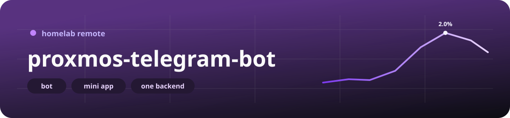
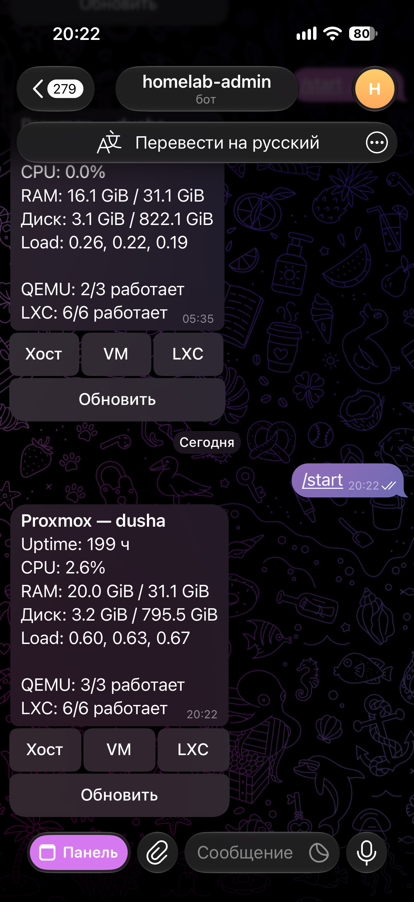
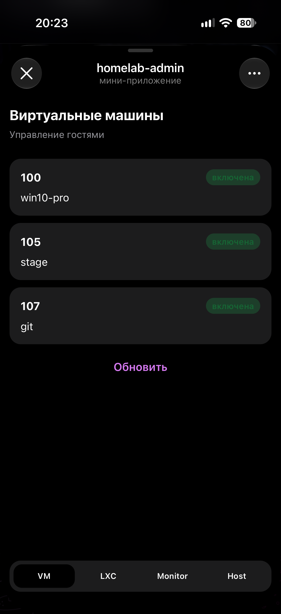
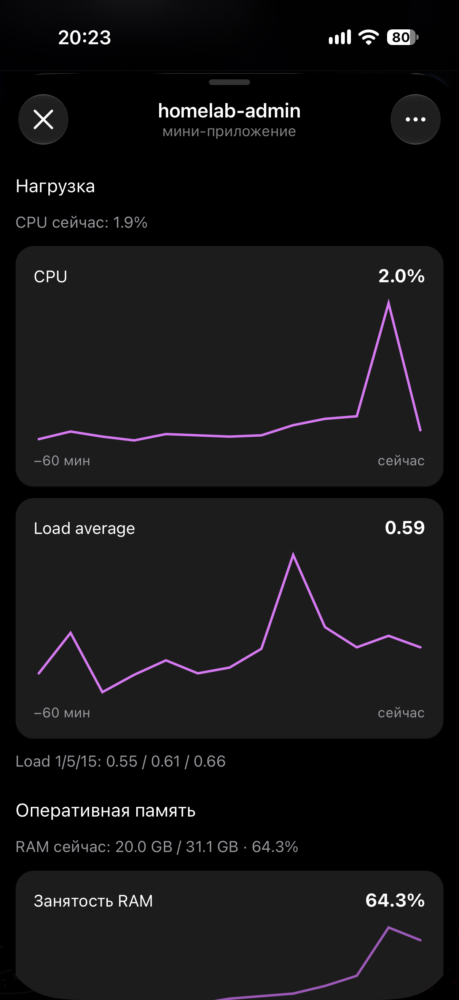

# proxmos-telegram-bot 🖥️💬

Русская версия: [README.md](README.md)

<p align="center">
  
</p>

<p align="center">
  
  
  
  
  
</p>

A pocket remote for a homelab Proxmox. The web UI on a phone is miserable, and powering off a VM should be two taps. That is the whole product.

### What it looks like

Left is the bot in a chat: a summary and buttons. The Mini App opens from the **Панель** button at the bottom of that same chat. Middle is the VM list inside the Mini App. Right is node monitoring, charts for the last hour.

This is my stand. Your bot name, guests, and numbers will be different.

<table>
  <tr>
    <td align="center" width="33%">
      
    </td>
    <td align="center" width="33%">
      
    </td>
    <td align="center" width="33%">
      
    </td>
  </tr>
  <tr>
    <td align="center"><b>bot in the chat</b><br>buttons, not the Mini App</td>
    <td align="center"><b>virtual machines</b><br>Mini App</td>
    <td align="center"><b>node monitoring</b><br>also the Mini App</td>
  </tr>
</table>

### What is inside

Four pieces. They only talk along the arrows below, otherwise you will never know who shut the host down.

| Piece | Who | Talks to |
|-------|-----|----------|
| [`bot/`](bot/README.en.md) | aiogram 3, long polling | the backend only |
| [`backend/`](backend/README.en.md) | FastAPI | Proxmox API `:8006`, Mongo, optional Influx |
| [`app/`](app/README.en.md) | SvelteKit Mini App + BFF | Telegram `initData` → the same backend |
| [`mock/`](mock/README.en.md) | fake PVE API | dev and demo, not prod |
| `mongo` | Mongo 7 | `admins` collection |

**Only the backend** talks to Proxmox. The bot and the Mini App have no idea `:8006` exists. Start, stop, host shutdown — all of it goes through the API, the guard, and the PVE token. One client, one set of privileges, one log.

```
Telegram ──polling──▶ bot ──HTTP──▶ api ──HTTPS :8006──▶ Proxmox VE
                         │            │
                         │            ├── Mongo (user+chat pairs)
                         │            └── Influx (charts, when it is up)
Mini App (HTTPS) ──initData──▶ BFF (web) ──HTTP──▶ api
```

Two trusted chats, one human. That human is you.

| Variable | Why |
|----------|-----|
| `ADMIN_USER_ID` | your Telegram user id |
| `ADMIN_CHAT_ID` | the group where the bot takes commands |
| `MINI_APP_CHAT_ID` | the chat you **open the Mini App from** (usually the private chat, so the id equals the user id) |

On startup the API writes both `(user_id, chat_id)` pairs into Mongo. Wrong user or wrong chat, and you get access denied. Open the Mini App from the ops group and you get the same thing: the BFF sends the chat id it was opened from, and the row stored for the app is `MINI_APP_CHAT_ID`. HTTPS is fine. You came in through the wrong door.

### Three ways to run it

1. **Laptop dev** — Mongo and the mock in Docker, API and bot on the host, Mini App via `npm run dev`.
2. **Demo stack** — `mock/docker-compose.yml`: mongo + mock + api + bot, no real PVE.
3. **Prod on Proxmox** — `docker-compose.prod.yml` inside an LXC (or VM) on the LAN, a real `pveproxy`, and only the Mini App facing the internet over HTTPS.

### Dev, four commands and you are in

```bash
cp backend/.env.dev.example backend/.env.dev
cp bot/.env.dev.example bot/.env.dev
cp app/.env.example app/.env
# BOT_API_TOKEN must match in backend, bot, and app
# backend: PROXMOX_* aimed at the mock, ADMIN_*, MONGO_*
# bot: TELEGRAM_BOT_TOKEN, API_BASE_URL=http://127.0.0.1:8000

docker compose -f docker-compose.dev.yml up --build
```

On the host: Mongo `127.0.0.1:27017`, mock `127.0.0.1:8006`.

```bash
cd backend && python run.py          # :8000
cd bot && python run.py              # polling
cd app && npm install && npm run dev # :5173, Authorization: dev
```

In `backend/.env.dev`: `MONGO_URL=mongodb://127.0.0.1:27017`, `PROXMOX_HOST=http://127.0.0.1:8006`, `PROXMOX_NODE=pve`.

Send `/start` **in the group** whose id is `ADMIN_CHAT_ID`. A private chat gets a quiet refusal unless that chat id is one of the trusted pairs.

### Demo when there is no hardware around

There is no `.env.demo.example` in the repo. Stop looking. Create a gitignored `.env.demo` at the root:

```bash
# .env.demo — Telegram, admin, mongo. Compose adds PROXMOX_* from mock/.env.proxmox.example
APP_ENV=dev
TELEGRAM_BOT_TOKEN=...
BOT_API_TOKEN=...          # same value as the API
ADMIN_USER_ID=...
ADMIN_CHAT_ID=...          # group
MINI_APP_CHAT_ID=...       # private chat
ADMIN_NAME=
MONGO_URL=mongodb://mongo:27017
MONGO_DB=proxmos_bot_demo
PROTECTED_GUESTS=lxc:100
API_BASE_URL=http://api:8000
WEBAPP_URL=
TELEGRAM_PROXY_URL=
```

```bash
docker compose -f mock/docker-compose.yml up --build
curl -s http://127.0.0.1:8000/health
```

LXC **100** in the fixture is protected. “Shut down the host” only logs a warning in the mock — the demo containers keep running. On a real PVE that same button kills the machine, so check which `PROXMOX_HOST` the API is pointed at. Reset from the compose network: `POST http://proxmox-mock:8006/mock/reset`.

---

<p align="center">
  
</p>

### Prod on Proxmox — do not skim this 🧯

The stack expects this picture (addresses come from `.env.prod.example`; use yours):

| Who | Example | Why |
|-----|---------|-----|
| PVE node, `pveproxy` | `https://192.168.1.10:8006` | the bot API calls this |
| LXC running the stack | `192.168.1.33` | Docker Compose; the Mini App listens on `:3000` **on this IP only** |
| InfluxDB 2 | `http://192.168.1.148:8086` | CPU / RAM / temperature charts |
| Nginx Proxy Manager | anywhere on the LAN | HTTPS for Telegram, upstream `http://192.168.1.33:3000` |

`api`, `bot`, and `mongo` publish no host ports. From the LXC host you cannot curl them; they live on the compose network. That is on purpose. `web` is the only published port, and it stays on the LAN. NPM is what puts HTTPS on the internet.

#### 1. Where the stack should live

The usual choice is a **dedicated LXC on the same node**.

The trap everyone hits once: the bot runs on the host you shut down. The command goes out, power drops, the LXC dies with PVE. Telegram cannot bring it back. A button on the case, IPMI, WoL — whatever you actually have. Reboot is kinder: the node comes back, and Docker `restart: unless-stopped` brings the stack up once the guest OS boots.

Worth doing:

- set `PROTECTED_GUESTS=lxc:<stack VMID>` so a stray stop from the bot cannot kill the remote. **That line does not block host shutdown.**
- keep “the LXC is protected” and “the host cannot be powered off” in two different drawers in your head.

If the remote must survive this node going down, run compose on another LAN machine. Same code; `PROXMOX_HOST` points at PVE over the network.

#### 2. The LXC that runs Docker

Docker inside an LXC on Proxmox needs extra kernel features or it just will not start. On the CT (unprivileged is fine):

```bash
pct set <CTID> --features nesting=1,keyctl=1
```

Or in `/etc/pve/lxc/<CTID>.conf`:

```
features: nesting=1,keyctl=1
```

Then **restart the CT**, not just Docker. If overlayfs complains about AppArmor, add this to the same file and restart the CT again:

```
lxc.apparmor.profile: unconfined
```

Inside the guest: Docker Engine, the Compose plugin, and a static IP (or a DHCP reservation). The address is hardcoded on the `web` service in `docker-compose.prod.yml`:

```yaml
ports:
  - "192.168.1.33:3000:3000"
```

Change the address and compose fails to bind — edit that line. `0.0.0.0:3000:3000` also works, but then plain HTTP for the Mini App sits on every interface of the LXC. On a home LAN, bind one address and let only NPM face the internet.

Clocks. The BFF checks `auth_date` inside `initData` (`INIT_DATA_MAX_AGE_SEC`, default one day). Bad NTP in the LXC shows up as “invalid init data” while the bot token is perfectly fine. Enable `systemd-timesyncd`.

DNS. The bot calls `api.telegram.org:443` itself. There is no webhook, so leave inbound 443 on the LXC closed. If Telegram is unreachable from this network, set `TELEGRAM_PROXY_URL` (`socks5://`, `socks5h://`, `http://`). The values `none`, `off`, `false`, and `-` mean “no proxy”.

#### 3. A Proxmox API token, leave the root password alone

The client sends:

```
Authorization: PVEAPIToken=<USER>@pam!<TOKENNAME>=<SECRET>
```

In env that is `PROXMOX_TOKEN_ID=bot@pam!telegram` and `PROXMOX_TOKEN_SECRET=...`. The secret is shown once. Do not close the tab until it is in `.env`.

How to create it and skip the classic 403:

1. Datacenter → Permissions → Users → a user such as `bot@pam`. You never need its password.
2. Permissions → API Tokens → Add. A name, for example `telegram`.
3. **Privilege Separation**. It is on by default, and then the token does **not** inherit the user’s permissions. Put the ACL on `bot@pam!telegram`, not on `bot@pam`. The classic: the token exists, the API returns 403, and you stare at the wrong object for an hour.
4. A role on `/` is enough for a single-node homelab. Narrower is fine if you want it. The client actually calls:
   - `GET /nodes`, `GET /nodes/{node}/status`, `GET .../rrddata`, `GET .../storage`
   - `GET /nodes/{node}/qemu` and `.../lxc`
   - `POST /nodes/{node}/{qemu|lxc}/{vmid}/status/{start|stop|shutdown|suspend|resume|reboot}`
   - `POST /nodes/{node}/status` with `command=shutdown|reboot`
5. A practical set: `Sys.Audit`, `Sys.PowerMgmt`, `VM.Audit`, `VM.PowerMgmt`, `Datastore.Audit`. `PVEAdmin` also works and grants more than this app uses. Fine on a homelab, a tight role if anyone else shares the node.
6. `PROXMOX_VERIFY_SSL=false` while you call `pveproxy` by IP with its self-signed cert. Turn verification on once you use a name that matches the certificate.
7. An empty `PROXMOX_NODE` means the API picks the node **only when there is exactly one**. Two or more, and it errors and tells you to set `PROXMOX_NODE`. Use the name from the PVE tree (`pve`, not the IP).
8. If the node or datacenter firewall is on, allow TCP `8006` **only** from the LXC IP. Packets from the `api` container leave with that LXC IP (Docker SNAT), not `172.17.0.0/16`. Write the LXC address in the firewall rule.
9. `PROXMOX_HOST` from inside the container is the PVE LAN address (`https://192.168.1.10:8006`). `127.0.0.1` inside `api` is the container itself; `pveproxy` is not listening there.

Proxmox VE 9 returns status as nested objects (`memory`, `rootfs`, `cpuinfo`). The backend flattens them into the old fields. Nothing extra to configure on the node.

#### 4. Metrics: Influx, or RRD if you do not have it

`METRICS_SOURCE=influx` is the default. Hourly charts come from Influx. The storage list and the live node status still come from Proxmox.

Influx is used only when both `INFLUX_URL` and `INFLUX_TOKEN` are set. No token, and it quietly falls back to Proxmox RRD (`metrics_source=proxmox` in the payload). Token set but Influx down, and `/node/metrics` returns **502** with no fallback. That is on purpose: a loud failure beats silently showing yesterday’s RRD and pretending it is fine.

Two buckets:

| Bucket | Source | Expected shape |
|--------|--------|----------------|
| `INFLUX_BUCKET_PROXMOX` (`proxmox`) | PVE exporter / Telegraf | measurements `cpustat` (`cpu`, `avg1`), `memory` (`memused`, `memtotal`), tag `host` |
| `INFLUX_BUCKET_HARDWARE` (`hardware`) | Telegraf on the **hypervisor** | `temp` / `smart_device`, CPU and disk temperatures |

`INFLUX_HOST_TAG` is the Influx `host` tag. It is often a different string from the PVE node name. The example tag is `dusha` while the node may be called `pve`. An empty tag falls back to `PROXMOX_NODE`, then to the string `pve`. Empty charts with a healthy Influx are almost always this mismatch. Check the tag before you touch anything else.

Disk temperature. `inputs.temp` on two NVMe drives often collapses into a single `nvme_composite`. The workaround is SMART per device on the PVE node itself (not inside the bot LXC): [`docs/telegraf-disk-temperature.example.conf`](docs/telegraf-disk-temperature.example.conf). `smartctl` via sudo for the `telegraf` user. Fields such as `temp_c`, tag `device=nvme0|sda|...`.

`GRAFANA_NODE_DASHBOARD_URL` is only a link in the metrics payload. The backend does not call it.

#### 5. Mini App and NPM

Telegram opens a WebApp only over **HTTPS**. A self-signed cert will not do.

1. Put the domain in BotFather.
2. `WEBAPP_URL` is the public URL. On startup the bot sets the menu button “Панель” to that URL. The same button you can see at the bottom of the chat screenshot.
3. The app is built for `/` (no `paths.base`). Give it its own host, for example `https://pve.example.com/`. A `/miniapp` path like the one in `.env.prod.example` works only if the proxy strips the prefix. SvelteKit client routing does not know about it out of the box.
4. NPM: Proxy Host → scheme `http`, forward the LXC IP, port `3000`, Websockets on, Let’s Encrypt, force SSL.
5. Open the Mini App from the `MINI_APP_CHAT_ID` chat. Opening it from the ops group is denied, and that is expected.
6. Secrets are not baked into `docker build`. The `web` image is built without `.env.prod`; variables arrive at runtime. Names live in `app/src/env.ts` (SvelteKit 3). Dropping a new secret into env is not enough — declare it there too, or the process pretends it does not exist.

#### 6. Bring prod up

```bash
cp .env.prod.example .env.prod
# tokens, chat ids, Proxmox and Influx IPs, WEBAPP_URL
# and the IP in the web service ports in docker-compose.prod.yml

docker compose -f docker-compose.prod.yml up -d --build
```

No manual admin registration: pairs are written when the API starts. Change an id in env and restart `api`; the new pair is upserted. **Old Mongo documents stay `active: true`.** Deactivate extras in the `admins` collection, or wipe the `mongo_data` volume if the stand is still empty and you have nothing to lose.

The API port is not published. Check from inside the container:

```bash
docker compose -f docker-compose.prod.yml exec api \
  python -c "import urllib.request; print(urllib.request.urlopen('http://127.0.0.1:8000/health').read())"
docker compose -f docker-compose.prod.yml logs -f bot api web
```

Upgrade with `git pull` and `up -d --build` again. Leave the Mongo volume alone unless you mean to drop it. Startup recreates pairs from env, but any hand-edited `active` flags go away with the volume.

#### 7. What the bot will not do

- power a host on after shutdown (no IPMI, no WoL);
- several nodes in one instance until you set `PROXMOX_NODE` (and even then, one instance is one node);
- PVE tasks / UPIDs, a console, backups, migrations;
- password login to PVE. API token only.

---

### Tests

Husky runs ruff + pytest for touched `backend/`, `bot/`, and `mock/`, plus `npm run lint` and `npm test` for `app/`. You need local `.venv` directories and `app/node_modules`.

```bash
cd backend && python -m venv .venv && .venv/bin/pip install -r requirements-dev.txt
.venv/bin/ruff check . && .venv/bin/ruff format --check . && .venv/bin/python -m pytest -q

cd bot && python -m venv .venv && .venv/bin/pip install -r requirements-dev.txt
.venv/bin/ruff check . && .venv/bin/ruff format --check . && .venv/bin/python -m pytest -q

cd mock && python -m venv .venv && .venv/bin/pip install -r requirements-dev.txt
.venv/bin/ruff check . && .venv/bin/ruff format --check . && .venv/bin/python -m pytest -q

cd app && npm install && npm run lint && npm test && npm run check
```

Or `uv sync --extra dev` in `backend/`, `bot/`, or `mock/`. Each Python package has its own `ruff.toml`; run the tools from that directory, or ruff picks up the wrong config and gets confused.

CI (`.github/workflows/ci.yml`) on `main` and `stage`: ruff, pytest, eslint, vitest, svelte-check.

### Where to look in the code

| Path | Why |
|------|-----|
| `backend/src/api/app.py` | HTTP API |
| `backend/src/proxmox/client.py` | PVE client |
| `backend/src/services/` | inventory, guard, power, metrics |
| `bot/core/main.py` | polling and the Mini App button |
| `bot/src/handlers/router.py` | bot keyboard |
| `bot/src/core/middleware.py` | `/access` on every update |
| `app/src/routes/api/` | BFF |
| `mock/app.py` | fake `/api2/json` |
| `docker-compose.prod.yml` | prod |
| `docker-compose.dev.yml` | mongo + mock |
| `mock/docker-compose.yml` | full demo |

Per-service docs: [backend](backend/README.en.md), [bot](bot/README.en.md), [app](app/README.en.md), [mock](mock/README.en.md).
