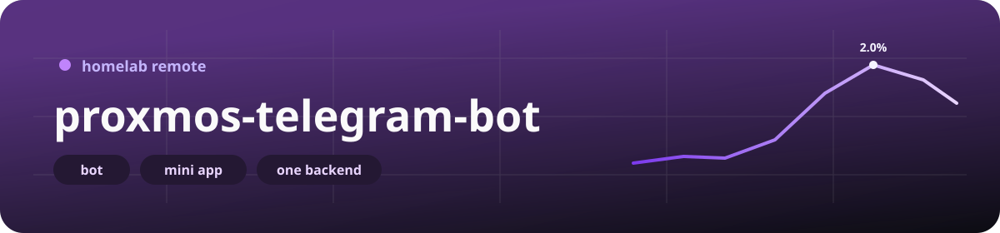
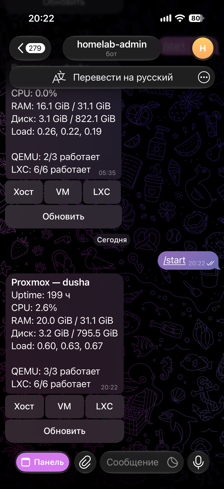
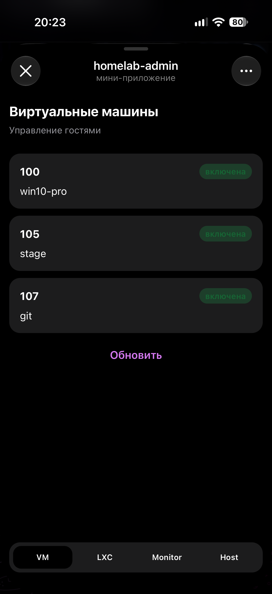
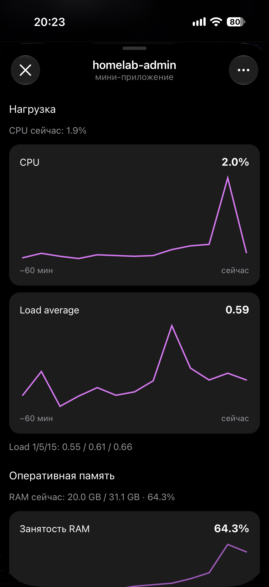

# proxmos-telegram-bot 🖥️💬

English: [README.en.md](README.en.md)

<p align="center">
  
</p>

<p align="center">
  
  
  
  
  
</p>

Пульт от домашней Proxmox, который живёт в Telegram. Веб-морда с телефона бесит, а выключить виртуалку хочется в два тапа — вот и всё.

### Как это выглядит

Слева обычный чат с ботом: сводка и кнопки. Мини-апп открывается кнопкой **«Панель»** внизу того же чата. Посередине список VM уже внутри мини-аппа, справа мониторинг ноды — графики за последний час.

Это мой стенд. Имя бота, виртуалки и цифры будут твои.

<table>
  <tr>
    <td align="center" width="33%">
      
    </td>
    <td align="center" width="33%">
      
    </td>
    <td align="center" width="33%">
      
    </td>
  </tr>
  <tr>
    <td align="center"><b>бот в чате</b><br>кнопки, не мини-апп</td>
    <td align="center"><b>виртуалки</b><br>мини-апп</td>
    <td align="center"><b>мониторинг ноды</b><br>тоже мини-апп</td>
  </tr>
</table>

### Что внутри

Четыре куска. Друг к другу они ходят только так, как нарисовано, иначе потом не понять, кто выключил хост.

| Кусок | Кто | Куда смотрит |
|-------|-----|----------------|
| [`bot/`](bot/README.md) | aiogram 3, long polling | только backend |
| [`backend/`](backend/README.md) | FastAPI | Proxmox API `:8006`, Mongo, по желанию Influx |
| [`app/`](app/README.md) | SvelteKit Mini App + BFF | Telegram `initData` → тот же backend |
| [`mock/`](mock/README.md) | фейковый PVE API | dev и demo, в прод его нет |
| `mongo` | Mongo 7 | коллекция `admins` |

В Proxmox ходит **только backend**. Бот и мини-апп про `:8006` даже не знают. Старт, стоп, «выключи хост» — всё через API, guard и токен PVE. Один клиент, одни права, один журнал.

```
Telegram ──polling──▶ bot ──HTTP──▶ api ──HTTPS :8006──▶ Proxmox VE
                         │            │
                         │            ├── Mongo (пары user+chat)
                         │            └── Influx (графики, если живой)
Mini App (HTTPS) ──initData──▶ BFF (web) ──HTTP──▶ api
```

Два доверенных чата, один человек. Это ты.

| Переменная | Зачем |
|------------|--------|
| `ADMIN_USER_ID` | твой Telegram user id |
| `ADMIN_CHAT_ID` | группа, где бот слушает команды |
| `MINI_APP_CHAT_ID` | чат, **из которого** открываешь Mini App (обычно личка, тогда id = user id) |

На старте API сам записывает обе пары `(user_id, chat_id)` в Mongo. Чужой user или чужой chat — «Нет доступа». Открыл мини-апп из ops-группы — тоже мимо: BFF отдаёт id того чата, откуда открыли, а в базе для приложения лежит `MINI_APP_CHAT_ID`. Это не «сломался HTTPS», ты просто не из той двери зашёл.

### Три способа запустить

1. **Dev на ноутбуке** — Mongo и mock в Docker, API и бот локально, Mini App через `npm run dev`.
2. **Demo-стек** — `mock/docker-compose.yml`: mongo + mock + api + bot, живого PVE нет.
3. **Prod на Proxmox** — `docker-compose.prod.yml` внутри LXC (или VM) в LAN, настоящий `pveproxy`, в интернет торчит только HTTPS мини-аппа.

### Dev, четыре команды и поехали

```bash
cp backend/.env.dev.example backend/.env.dev
cp bot/.env.dev.example bot/.env.dev
cp app/.env.example app/.env
# BOT_API_TOKEN одинаковый в backend, bot и app
# backend: PROXMOX_* на mock, ADMIN_*, MONGO_*
# bot: TELEGRAM_BOT_TOKEN, API_BASE_URL=http://127.0.0.1:8000

docker compose -f docker-compose.dev.yml up --build
```

На хосте появятся Mongo `127.0.0.1:27017` и mock `127.0.0.1:8006`.

```bash
cd backend && python run.py          # :8000
cd bot && python run.py              # polling
cd app && npm install && npm run dev # :5173, Authorization: dev
```

В `backend/.env.dev`: `MONGO_URL=mongodb://127.0.0.1:27017`, `PROXMOX_HOST=http://127.0.0.1:8006`, `PROXMOX_NODE=pve`.

`/start` пиши **в группе** с `ADMIN_CHAT_ID`. В личке бот промолчит отказом, если этот chat id ему не знаком.

### Demo, когда железа под рукой нет

`.env.demo.example` в репозитории нет, не ищи. Собери `.env.demo` в корне сам (он в gitignore):

```bash
# .env.demo — Telegram, админ, mongo. PROXMOX_* compose подмешает из mock/.env.proxmox.example
APP_ENV=dev
TELEGRAM_BOT_TOKEN=...
BOT_API_TOKEN=...          # тот же, что у API
ADMIN_USER_ID=...
ADMIN_CHAT_ID=...          # группа
MINI_APP_CHAT_ID=...       # личка
ADMIN_NAME=
MONGO_URL=mongodb://mongo:27017
MONGO_DB=proxmos_bot_demo
PROTECTED_GUESTS=lxc:100
API_BASE_URL=http://api:8000
WEBAPP_URL=
TELEGRAM_PROXY_URL=
```

```bash
docker compose -f mock/docker-compose.yml up --build
curl -s http://127.0.0.1:8000/health
```

LXC **100** в фикстуре защищён. «Выключить хост» в mock только пишет warning в лог — контейнеры demo остаются живы. На настоящем PVE та же кнопка гасит железо, не перепутай, куда смотрит `PROXMOX_HOST`. Сброс фикстуры из сети compose: `POST http://proxmox-mock:8006/mock/reset`.

---

<p align="center">
  
</p>

### Prod на Proxmox — не пролистывай 🧯

Картинка, под которую заточен стек (адреса из `.env.prod.example`, подставь свои):

| Кто | Пример | Зачем |
|-----|--------|--------|
| Нода PVE, `pveproxy` | `https://192.168.1.10:8006` | сюда ходит API |
| LXC со стеком | `192.168.1.33` | Docker Compose, Mini App слушает `:3000` **только на этом IP** |
| InfluxDB 2 | `http://192.168.1.148:8086` | графики CPU / RAM / температур |
| Nginx Proxy Manager | где угодно в LAN | HTTPS для Telegram, upstream `http://192.168.1.33:3000` |

`api`, `bot` и `mongo` наружу порты не публикуют. С хоста LXC их не видно, они сидят в сети compose. Так и надо. Единственная дырка — Mini App (`web`), и то в LAN. В интернет его выпускает NPM с сертификатом.

#### 1. Куда поселить контейнер со стеком

Обычно это **отдельный LXC на той же ноде**.

Ловушка, в которую все наступают один раз: бот живёт на том хосте, который ты выключаешь. Команда ушла, питание снялось, LXC умер вместе с PVE. Обратно из Telegram уже никак. Кнопка на корпусе, IPMI, WoL — что есть, то и жми. Reboot чуть добрее: нода встанет сама, Docker с `restart: unless-stopped` поднимет стек, если гостевая ОС вообще стартанула.

Имеет смысл:

- прописать `PROTECTED_GUESTS=lxc:<VMID стека>`, чтобы случайный stop из бота не прибил пульт. **Shutdown хоста эта строка не держит.**
- помнить, что «LXC защищён» и «хост теперь бессмертный» — разные истории.

Если пульт должен пережить выключение этой ноды — крути compose на другой машине в LAN. Код тот же, `PROXMOX_HOST` смотрит на PVE по сети.

#### 2. LXC, внутри которого Docker

Docker в LXC на Proxmox без фич ядра просто не взлетит. На CT (непривилегированный — нормально):

```bash
pct set <CTID> --features nesting=1,keyctl=1
```

Или в `/etc/pve/lxc/<CTID>.conf`:

```
features: nesting=1,keyctl=1
```

Дальше **рестарт CT**, не «я перезапустил docker и надеюсь». Если overlay орёт про AppArmor, в тот же conf и снова рестарт CT:

```
lxc.apparmor.profile: unconfined
```

Внутри гостя: Docker Engine, plugin Compose, статичный IP (или резервация DHCP). IP зашит в `ports` сервиса `web` в `docker-compose.prod.yml`:

```yaml
ports:
  - "192.168.1.33:3000:3000"
```

Адрес сменился — compose не забиндится, правь строку. `0.0.0.0:3000:3000` тоже заведётся, но тогда голый HTTP мини-аппа торчит на всех интерфейсах LXC. Дома обычно хватает одного адреса, а наружу смотрит только NPM.

Часы. BFF проверяет `auth_date` в `initData` (`INIT_DATA_MAX_AGE_SEC`, по умолчанию сутки). Кривой NTP в LXC выглядит как «invalid init data», хотя токен бота верный. Включи `systemd-timesyncd`.

DNS. Бот сам ходит на `api.telegram.org:443`. Webhook нет, входящий 443 на LXC ради бота не открывай. Telegram с этой сети не достать — ставь `TELEGRAM_PROXY_URL` (`socks5://`, `socks5h://`, `http://`). `none` / `off` / `false` / `-` значат «без прокси».

#### 3. Токен Proxmox, пароль root тут не при чём

Клиент шлёт заголовок:

```
Authorization: PVEAPIToken=<USER>@pam!<TOKENNAME>=<SECRET>
```

В env это `PROXMOX_TOKEN_ID=bot@pam!telegram` и `PROXMOX_TOKEN_SECRET=...`. Секрет показывают один раз. Не закрывай вкладку, пока не вставил его в `.env`.

Как завести и не словить 403:

1. Datacenter → Permissions → Users → пользователь вроде `bot@pam`. Пароль ему можно не задавать вообще.
2. Permissions → API Tokens → Add. Имя, например `telegram`.
3. Галка **Privilege Separation**. Она включена по умолчанию, и тогда токен **не** наследует права пользователя. ACL вешай на `bot@pam!telegram`, а не на `bot@pam`. Классика: токен есть, API отвечает 403, ты час смотришь не туда.
4. Роль на путь `/` для одной домашней ноды — нормально. Хочешь уже — делай уже. Клиент реально дёргает:
   - `GET /nodes`, `GET /nodes/{node}/status`, `GET .../rrddata`, `GET .../storage`
   - `GET /nodes/{node}/qemu` и `.../lxc`
   - `POST /nodes/{node}/{qemu|lxc}/{vmid}/status/{start|stop|shutdown|suspend|resume|reboot}`
   - `POST /nodes/{node}/status` с `command=shutdown|reboot`
5. Практичный набор: `Sys.Audit`, `Sys.PowerMgmt`, `VM.Audit`, `VM.PowerMgmt`, `Datastore.Audit`. `PVEAdmin` тоже взлетит и даст лишнего. На домашнем PVE так иногда и оставляют, на чём-то общем лучше узкая роль.
6. `PROXMOX_VERIFY_SSL=false`, пока ходишь по IP на самоподписанный сертификат `pveproxy`. По имени из сертификата проверку можно включить.
7. Пустой `PROXMOX_NODE` — API само возьмёт ноду, **если она ровно одна**. Две и больше — ошибка «задайте PROXMOX_NODE». Имя как в дереве PVE (`pve`, не IP).
8. Файрвол ноды или датацентра, если включён: TCP `8006` **только** с IP LXC. Из контейнера `api` пакеты выходят с IP этого LXC (SNAT докера), не с `172.17.0.0/16`. В правиле пиши адрес LXC.
9. `PROXMOX_HOST` из контейнера — LAN-адрес PVE (`https://192.168.1.10:8006`). `127.0.0.1` внутри контейнера `api` — это сам контейнер, `pveproxy` там не слушает.

Proxmox VE 9 отдаёт status вложенными объектами (`memory`, `rootfs`, `cpuinfo`). Backend разворачивает их в старые плоские поля. На ноде для этого ничего дописывать не надо.

#### 4. Метрики: Influx, а если его нет — RRD

`METRICS_SOURCE=influx` по умолчанию. Графики за час читаются из Influx. Список storage и «живой» status ноды всё равно идут в Proxmox.

Influx включается, только если заданы и `INFLUX_URL`, и `INFLUX_TOKEN`. Токена нет — тихий откат на RRD Proxmox (`metrics_source=proxmox` в ответе). Токен есть, а Influx лежит — `/node/metrics` ответит **502**, отката не будет. Так задумано: лучше громко упасть, чем молча показать вчерашний RRD и сделать вид, что всё ок.

Два бакета:

| Бакет | Откуда | Что ждём |
|-------|--------|----------|
| `INFLUX_BUCKET_PROXMOX` (`proxmox`) | экспортёр PVE / Telegraf | measurement `cpustat` (`cpu`, `avg1`), `memory` (`memused`, `memtotal`), тег `host` |
| `INFLUX_BUCKET_HARDWARE` (`hardware`) | Telegraf на **гипервизоре** | `temp` / `smart_device`, температуры CPU и дисков |

`INFLUX_HOST_TAG` — тег `host` в Influx. Имя ноды PVE тут ни при чём, они часто разные. В примере тег `dusha`, а нода может зваться `pve`. Пустой тег → берётся `PROXMOX_NODE`, иначе строка `pve`. Графики пустые, Influx при этом живой — почти всегда вот этот рассинхрон. Сначала проверь тег, потом уже всё остальное.

Температура дисков. `inputs.temp` на двух NVMe часто склеивается в один `nvme_composite`. Рабочий обход — SMART по каждому диску на самой ноде PVE (не внутри LXC бота): [`docs/telegraf-disk-temperature.example.conf`](docs/telegraf-disk-temperature.example.conf). `smartctl` через sudo для пользователя `telegraf`. Поля вроде `temp_c`, тег `device=nvme0|sda|...`.

`GRAFANA_NODE_DASHBOARD_URL` — просто ссылка в ответе метрик. Backend по ней не ходит.

#### 5. Mini App и NPM

Telegram открывает WebApp только по **HTTPS**. Самоподписанный сертификат он не проглотит, нужен нормальный.

1. Домен положи в BotFather.
2. `WEBAPP_URL` — публичный URL. На старте бот ставит menu button «Панель» на этот адрес. Ту самую кнопку, что на скрине снизу.
3. Приложение собрано с корня `/` (`paths.base` нет). Отдай ему свой хост, например `https://pve.example.com/`. Путь `/miniapp` из `.env.prod.example` заработает, только если прокси сам срезает префикс. Клиентский роутинг SvelteKit про такой префикс из коробки не знает.
4. NPM: Proxy Host → scheme `http`, forward IP LXC, port `3000`, Websockets on, SSL Let's Encrypt, Force SSL.
5. Открывай Mini App из чата `MINI_APP_CHAT_ID`. Из ops-группы будет отказ, и это ожидаемо.
6. Секреты в `docker build` не запекаются. Образ `web` собирается без `.env.prod`, переменные приезжают в рантайме. Имена — в `app/src/env.ts` (SvelteKit 3). Новую секретную переменную мало положить в env, её надо ещё объявить там, иначе процесс её «не видит».

#### 6. Поднять прод

```bash
cp .env.prod.example .env.prod
# токены, id чатов, IP Proxmox и Influx, WEBAPP_URL
# и IP в ports сервиса web в docker-compose.prod.yml

docker compose -f docker-compose.prod.yml up -d --build
```

Админа руками регистрировать не надо: пары пишутся при старте API. Поменял id в env — перезапусти `api`, новая пара upsert-нется. **Старые документы в Mongo останутся `active: true`.** Лишние сними в коллекции `admins`, или снеси volume `mongo_data`, если стенд ещё пустой и терять нечего.

Порт API на хост не проброшен. Проверка из контейнера:

```bash
docker compose -f docker-compose.prod.yml exec api \
  python -c "import urllib.request; print(urllib.request.urlopen('http://127.0.0.1:8000/health').read())"
docker compose -f docker-compose.prod.yml logs -f bot api web
```

Обновление: `git pull` и снова `up -d --build`. Volume Mongo не трогай, если не хочешь его потерять. Пары из env при старте вернутся, а ручные правки `active` сгорят вместе с volume.

#### 7. Чего бот не умеет

- включить хост после shutdown (IPMI и WoL тут нет);
- несколько нод в одном инстансе, пока не задан `PROXMOX_NODE` (и даже с ним один инстанс = одна нода);
- задачи PVE / UPID, консоль, бэкапы, миграции;
- логин паролем PVE. Только API token.

---

### Тесты

Перед коммитом Husky гоняет ruff + pytest по затронутым `backend/`, `bot/`, `mock/` и `npm run lint` + `npm test` по `app/`. Нужны локальные `.venv` и `app/node_modules`.

```bash
cd backend && python -m venv .venv && .venv/bin/pip install -r requirements-dev.txt
.venv/bin/ruff check . && .venv/bin/ruff format --check . && .venv/bin/python -m pytest -q

cd bot && python -m venv .venv && .venv/bin/pip install -r requirements-dev.txt
.venv/bin/ruff check . && .venv/bin/ruff format --check . && .venv/bin/python -m pytest -q

cd mock && python -m venv .venv && .venv/bin/pip install -r requirements-dev.txt
.venv/bin/ruff check . && .venv/bin/ruff format --check . && .venv/bin/python -m pytest -q

cd app && npm install && npm run lint && npm test && npm run check
```

Либо `uv sync --extra dev` в `backend/`, `bot/`, `mock/`. Свой `ruff.toml` в каждом Python-каталоге, команды запускай оттуда, иначе ruff найдёт чужой конфиг и удивится.

CI (`.github/workflows/ci.yml`) на `main` и `stage`: ruff, pytest, eslint, vitest, svelte-check.

### Куда смотреть в коде

| Путь | Зачем |
|------|--------|
| `backend/src/api/app.py` | HTTP API |
| `backend/src/proxmox/client.py` | клиент PVE |
| `backend/src/services/` | inventory, guard, power, метрики |
| `bot/core/main.py` | polling и кнопка Mini App |
| `bot/src/handlers/router.py` | клавиатура бота |
| `bot/src/core/middleware.py` | `/access` на каждый апдейт |
| `app/src/routes/api/` | BFF |
| `mock/app.py` | фейковый `/api2/json` |
| `docker-compose.prod.yml` | прод |
| `docker-compose.dev.yml` | mongo + mock |
| `mock/docker-compose.yml` | полный demo |

Подробности по кускам: [backend](backend/README.md), [bot](bot/README.md), [app](app/README.md), [mock](mock/README.md).
