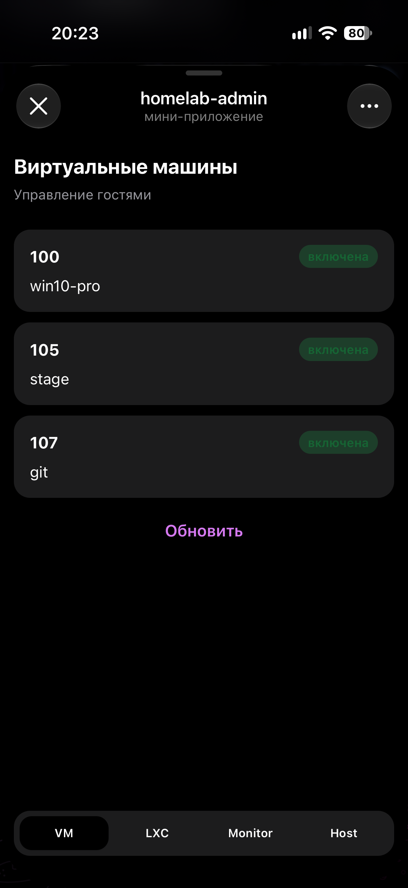
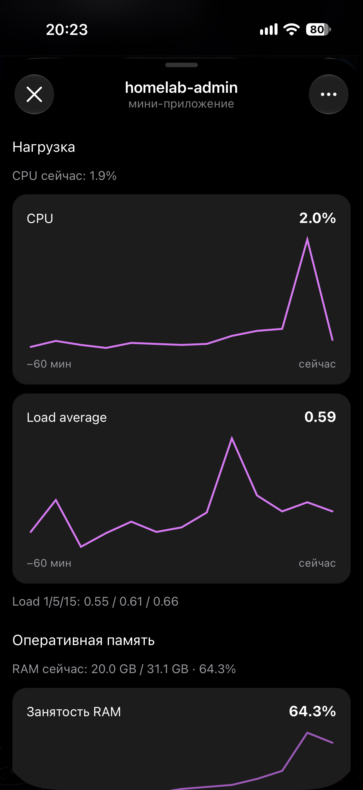

# Mini App 📱 — SvelteKit inside Telegram

Русская версия: [README.md](README.md)

A WebApp panel: VMs, LXC, node charts, host power. The UI does not call Proxmox, and it does not call FastAPI either. The browser talks to this app’s BFF, the BFF checks `initData`, then calls the backend.

Left is the VM list, right is node monitoring. Both are the Mini App. The chat with buttons is the [bot](../bot/README.en.md), a different door.

<p>
  
  
</p>

Prod on Proxmox, NPM, and the PVE token: [root README](../README.en.md).

### Two layers

**UI** — Svelte 5 (runes) + Tailwind 4, FSD-shaped layout under `src/lib/`:

| Layer | Path | What is inside |
|-------|------|----------------|
| `pages` | `src/lib/pages/` | screens: guests, card, monitoring, host |
| `widgets` | `src/lib/widgets/` | header, bottom nav, charts, sections |
| `features` | `src/lib/features/` | calls: list, action, metrics, health |
| `entities` | `src/lib/entities/` | guest, session, metric labels |
| `shared` | `src/lib/shared/` | buttons, toasts, DTO types |

**BFF** — `src/routes/api/**` and `src/lib/server/`. Every request:

1. Read `Authorization`.
2. In prod: `tma <initData>`. The HMAC is checked with `TELEGRAM_BOT_TOKEN`, and `auth_date` must be newer than `INIT_DATA_MAX_AGE_SEC` (default 86400).
3. User id and chat id come from `initData`.
4. Then the same headers as the bot: `X-Bot-Token`, `X-Telegram-User-Id`, `X-Telegram-Chat-Id` → `API_BASE_URL`.

The backend only allows a Mongo pair. For the Mini App that pair is `(ADMIN_USER_ID, MINI_APP_CHAT_ID)`. Open the app from the ops group and the chat id is the group, the pair misses, and the access screen stays shut. That is not “HTTPS is broken”. Open it from the chat whose id is configured. Usually the private chat, so `MINI_APP_CHAT_ID` equals the user id.

With `APP_ENV=dev`, a browser outside Telegram sends `Authorization: dev`. The BFF substitutes `DEV_ADMIN_USER_ID` and `DEV_MINI_APP_CHAT_ID`. In prod that branch is off, even if you send the header yourself.

Clocks. `auth_date` is checked on the machine running `web`. An LXC without NTP and a drifted clock produces `invalid init data` with a perfectly good token. Enable `systemd-timesyncd` in the guest.

### Screens

Bottom nav (`navItems`):

| Label | Path |
|-------|------|
| VM | `/guests/qemu` |
| LXC | `/guests/lxc` |
| Monitor | `/monitoring` |
| Host | `/host` |

Guest power: `start`, `stop`, `shutdown`, `reboot`, `suspend`, `resume`. After the command the BFF waits for the status itself (`src/lib/server/backend/waitGuestStatus.ts`), same idea as the bot.

Host: a health check, shutdown, and reboot, each behind two dialogs. If this `web` process lives on the node you power off, the tab simply stops loading after you confirm. The Mini App cannot power the server back on. Backend `PROTECTED_GUESTS` does not block node power, only stop/shutdown of specific guests — put the VMID of the LXC that runs compose in that list.

Monitoring draws whatever `/node/metrics` returned: load, memory, CPU temperature, disk temperature, storage. Empty charts while PVE is healthy are usually Influx and `INFLUX_HOST_TAG`. That is configured on the backend, not here.

### BFF routes

| Route | Meaning |
|-------|---------|
| GET `/api/me` | access check |
| GET `/api/guests?kind=qemu\|lxc` | list |
| GET `/api/guests/:kind/:vmid` | card |
| POST `/api/guests/:kind/:vmid/:action` | power + status poll |
| GET `/api/node/metrics` | metrics |
| GET `/api/node/health` | health |
| POST `/api/node/shutdown` | node shutdown |
| POST `/api/node/reboot` | node reboot |

Backend errors are forwarded with the same status. A 502 from FastAPI shows up on the client as `proxmox_error` (a dead Influx lands there too).

### Environment

Names are declared in `src/env.ts`. SvelteKit 3 only exposes server env that is listed there. Dropping a new secret into `.env` is not enough — add it to that file or the runtime will not see it.

Secrets are read when the process starts, not during `docker build`. The image is built without `.env.prod`. Compose injects them with `env_file`.

| Variable | Why |
|----------|-----|
| `APP_ENV` | `dev` enables `Authorization: dev` |
| `TELEGRAM_BOT_TOKEN` | HMAC for `initData`, same value as the bot |
| `BOT_API_TOKEN` | secret for FastAPI, same value as the backend |
| `API_BASE_URL` | locally `http://127.0.0.1:8000`; compose overrides to `http://api:8000` |
| `INIT_DATA_MAX_AGE_SEC` | max age of `auth_date` |
| `DEV_ADMIN_USER_ID` | dev only |
| `DEV_MINI_APP_CHAT_ID` | dev only; must match a Mongo pair |

Template: [`app/.env.example`](.env.example). In prod the same keys live in the root `.env.prod`. `DEV_*` is unused there.

`MINI_APP_CHAT_ID` in `.env.prod` is read by the **backend** (and you must open the app from that chat). The BFF does not compare that id itself: it takes the chat from `initData` and forwards it.

### Local

Start the backend (plus mongo and the mock if you have no PVE), then:

```bash
cd app
cp .env.example .env
npm install
npm run dev
```

<http://localhost:5173> uses dev auth. `DEV_MINI_APP_CHAT_ID` is the chat id the backend wrote on startup.

### Prod: LXC, port, NPM, BotFather

The `web` service in `docker-compose.prod.yml`:

- image `app/Docker/Dockerfile.prod`, Node 22, `adapter-node`, `node build`, port 3000;
- `HOST=0.0.0.0`, `PORT=3000`, `BODY_SIZE_LIMIT=Infinity` (so the adapter does not reject the request body);
- published **on the LXC LAN IP**, in the example `192.168.1.33:3000:3000`.

That IP has to be the address of the container running compose, and it should be static. If DHCP changes it, the bind fails — edit `ports` and bring the service back up. NPM calls `http://<that-ip>:3000` over HTTP on the LAN. Only NPM is exposed further out.

Telegram opens a WebApp only over HTTPS with a valid certificate.

1. A dedicated NPM proxy host, scheme `http`, forward to the LXC IP, port `3000`, websockets on, Let’s Encrypt, force SSL.
2. The app is built with the default `paths.base`, i.e. the site root. `WEBAPP_URL` like `https://pve.example.com/` is what you want. A `/miniapp` suffix from the example env is not served by itself: the client router expects `/guests/...`, not `/miniapp/guests/...`.
3. Put the domain in BotFather. Put the same `WEBAPP_URL` in the bot env. On startup the bot sets the menu button “Панель”.
4. Open it from the `MINI_APP_CHAT_ID` chat.

Rebuild just the panel:

```bash
docker compose -f docker-compose.prod.yml up -d --build web
```

`api` must already be on the same compose network, or `API_BASE_URL=http://api:8000` will not resolve.

### Scripts

| Command | Why |
|---------|-----|
| `npm run dev` | Vite + BFF |
| `npm run build` / `preview` | adapter production build |
| `npm run lint` / `lint:fix` | ESLint |
| `npm run check` | svelte-check |
| `npm test` | vitest (initData, access) |

```bash
cd app && npm install
npm run lint && npm test && npm run check
```
