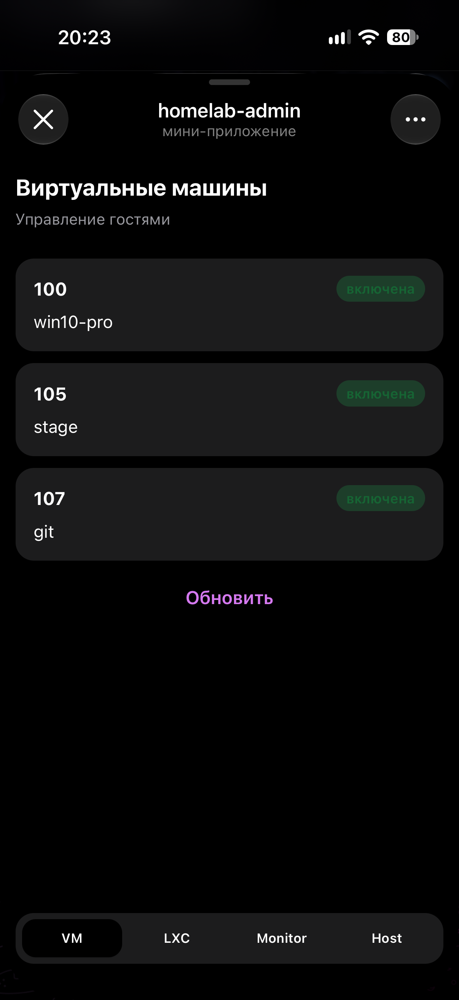
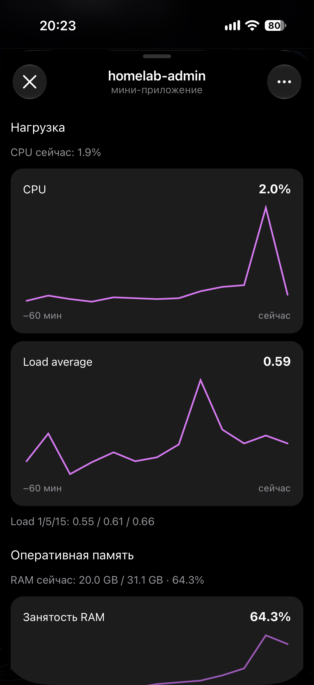

# Mini App 📱 — SvelteKit внутри Telegram

English: [README.en.md](README.en.md)

Панель в WebApp: VM, LXC, графики ноды, питание хоста. UI в Proxmox не ходит и в FastAPI напрямую тоже. Браузер стучится в BFF этого же приложения, BFF проверяет `initData` и уже потом зовёт backend.

Слева список виртуалок, справа мониторинг ноды. Обе картинки — мини-апп. Чат с кнопками — это [бот](../bot/README.md), другая дверь.

<p>
  
  
</p>

Прод на Proxmox, NPM, токен PVE: [корневой README](../README.md).

### Два слоя

**UI** — Svelte 5 (runes) + Tailwind 4, раскладка близкая к FSD в `src/lib/`:

| Слой | Путь | Что внутри |
|------|------|------------|
| `pages` | `src/lib/pages/` | экраны: гости, карточка, мониторинг, хост |
| `widgets` | `src/lib/widgets/` | шапка, нижнее меню, графики, секции |
| `features` | `src/lib/features/` | запросы: список, действие, метрики, health |
| `entities` | `src/lib/entities/` | гость, сессия, подписи метрик |
| `shared` | `src/lib/shared/` | кнопки, тосты, типы DTO |

**BFF** — `src/routes/api/**` и `src/lib/server/`. На каждый запрос:

1. Заголовок `Authorization`.
2. В проде: `tma <initData>`. Подпись HMAC сверяется с `TELEGRAM_BOT_TOKEN`, `auth_date` не старше `INIT_DATA_MAX_AGE_SEC` (дефолт 86400).
3. Из `initData` берутся user id и chat id.
4. Дальше те же заголовки, что у бота: `X-Bot-Token`, `X-Telegram-User-Id`, `X-Telegram-Chat-Id` → `API_BASE_URL`.

Backend пускает только пару из Mongo. Для Mini App это `(ADMIN_USER_ID, MINI_APP_CHAT_ID)`. Открыл приложение из ops-группы — chat id групповой, пара не находится, экран доступа закрыт. Это не «сломался HTTPS». Открывай из того чата, чей id прописан. Обычно личка, и тогда `MINI_APP_CHAT_ID` равен user id.

В `APP_ENV=dev` браузер без Telegram шлёт `Authorization: dev`. BFF подставляет `DEV_ADMIN_USER_ID` и `DEV_MINI_APP_CHAT_ID`. В проде эта ветка выключена, даже если заголовок прислать руками.

Часы. Проверка `auth_date` идёт на машине, где крутится `web`. LXC без NTP с уехавшими часами даёт `invalid init data` при живом токене. Включи `systemd-timesyncd` в госте.

### Экраны

Нижнее меню (`navItems`):

| Подпись | Путь |
|---------|------|
| VM | `/guests/qemu` |
| LXC | `/guests/lxc` |
| Monitor | `/monitoring` |
| Host | `/host` |

Питание гостя: `start`, `stop`, `shutdown`, `reboot`, `suspend`, `resume`. BFF после команды сам ждёт статус (`src/lib/server/backend/waitGuestStatus.ts`), как бот.

Хост: health-check, выключение и перезагрузка, каждое в два диалога. Если этот `web` живёт на выключаемой ноде, после подтверждения вкладка просто перестанет открываться. Включить сервер из Mini App нельзя. `PROTECTED_GUESTS` на backend не блокирует питание ноды, только stop/shutdown конкретных гостей — имеет смысл вписать туда VMID LXC, в котором крутится compose.

Мониторинг рисует ряды, которые отдал `/node/metrics`: нагрузка, память, температура CPU, температура дисков, storage. Пустые графики при живом PVE чаще всего про Influx и `INFLUX_HOST_TAG`, это настраивается на backend, не здесь.

### BFF-ручки

| Ручка | Смысл |
|-------|--------|
| GET `/api/me` | проверка доступа |
| GET `/api/guests?kind=qemu\|lxc` | список |
| GET `/api/guests/:kind/:vmid` | карточка |
| POST `/api/guests/:kind/:vmid/:action` | питание + опрос статуса |
| GET `/api/node/metrics` | метрики |
| GET `/api/node/health` | health |
| POST `/api/node/shutdown` | выключение ноды |
| POST `/api/node/reboot` | перезагрузка ноды |

Ошибки backend прокидываются с тем же кодом. 502 с FastAPI на клиенте выглядит как `proxmox_error` (туда же попадает и мёртвый Influx).

### Переменные

Имена объявлены в `src/env.ts`. SvelteKit 3 отдаёт в серверный код только то, что там описано. Новую секретную переменную мало положить в `.env` — её надо добавить в этот файл, иначе рантайм её «не видит».

Секреты читаются при старте процесса, не при `docker build`. Образ собирается без `.env.prod`. В compose они приезжают через `env_file`.

| Переменная | Зачем |
|------------|--------|
| `APP_ENV` | `dev` включает `Authorization: dev` |
| `TELEGRAM_BOT_TOKEN` | HMAC `initData`, тот же, что у бота |
| `BOT_API_TOKEN` | секрет до FastAPI, тот же, что у backend |
| `API_BASE_URL` | локально `http://127.0.0.1:8000`; compose перебивает на `http://api:8000` |
| `INIT_DATA_MAX_AGE_SEC` | свежесть `auth_date` |
| `DEV_ADMIN_USER_ID` | только dev |
| `DEV_MINI_APP_CHAT_ID` | только dev, должен совпасть с парой в Mongo |

Шаблон: [`app/.env.example`](.env.example). В проде те же ключи лежат в корневом `.env.prod`. `DEV_*` там не нужны.

`MINI_APP_CHAT_ID` в `.env.prod` читает **backend** (и ты должен открывать приложение из этого чата). BFF сам этот id из env не сравнивает: он берёт chat из `initData` и отдаёт backend как есть.

### Локально

Подними backend (и mongo, и mock, если без PVE), затем:

```bash
cd app
cp .env.example .env
npm install
npm run dev
```

<http://localhost:5173> ходит с dev-авторизацией. `DEV_MINI_APP_CHAT_ID` = chat id, который backend уже записал при старте.

### Prod: LXC, порт, NPM, BotFather

Сервис `web` в `docker-compose.prod.yml`:

- образ `app/Docker/Dockerfile.prod`, Node 22, `adapter-node`, `node build`, порт 3000;
- `HOST=0.0.0.0`, `PORT=3000`, `BODY_SIZE_LIMIT=Infinity` (чтобы адаптер не отрезал тело запроса);
- публикация **на LAN-IP LXC**, в примере `192.168.1.33:3000:3000`.

Этот IP должен быть адресом контейнера, где запущен compose, и лучше статикой. DHCP сменил адрес — bind упадёт, поправь `ports` и подними заново. NPM ходит на `http://<этот-ip>:3000` по HTTP внутри LAN. Наружу отдаёт только NPM.

Telegram открывает WebApp исключительно по HTTPS с валидным сертификатом.

1. Отдельный хост в NPM, scheme `http`, forward на IP LXC, port `3000`, websockets включены, Let's Encrypt, force SSL.
2. Приложение собрано с `paths.base` по умолчанию, то есть с корня сайта. `WEBAPP_URL` вида `https://pve.example.com/` — то, что нужно. Суффикс `/miniapp` из примера env сам по себе не обслуживается: клиентский роутер ждёт маршруты на `/guests/...`, а не на `/miniapp/guests/...`.
3. В BotFather — домен. В env бота — тот же `WEBAPP_URL`. Бот на старте ставит menu button «Панель».
4. Открыть из чата `MINI_APP_CHAT_ID`.

Пересобрать только панель:

```bash
docker compose -f docker-compose.prod.yml up -d --build web
```

`api` должен уже быть в той же сети compose, иначе `API_BASE_URL=http://api:8000` не резолвится.

### Скрипты

| Команда | Зачем |
|---------|--------|
| `npm run dev` | Vite + BFF |
| `npm run build` / `preview` | прод-сборка адаптера |
| `npm run lint` / `lint:fix` | ESLint |
| `npm run check` | svelte-check |
| `npm test` | vitest (initData, доступ) |

```bash
cd app && npm install
npm run lint && npm test && npm run check
```
