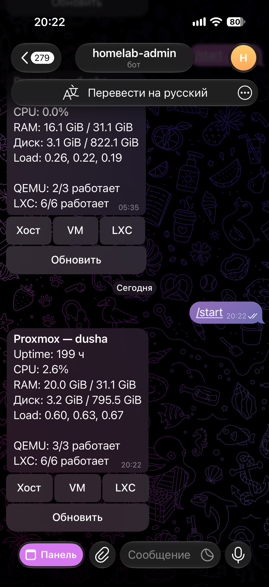

# Bot 🤖 — Telegram buttons, and it has never heard of Proxmox

Русская версия: [README.md](README.md)

aiogram 3, long polling. A summary, QEMU/LXC lists, guest power with a confirm, and a two-step host shutdown. It does not talk to PVE. It talks to the backend, and that is enough.

Here is the chat. This is not the Mini App: a message, buttons under it. The **Панель** button at the bottom of the screen opens the Mini App — that one lives in [app](../app/README.en.md).



The whole stand, the LXC, and the PVE token: [root README](../README.en.md). API contract: [backend](../backend/README.en.md).

### How a message gets in

`core/main.py` builds a `Bot` and a `Dispatcher`, installs `AccessMiddleware` on every update, and only then lets `src/handlers/router.py` run.

The middleware (`src/core/middleware.py`) reads `from_user.id` and `chat.id` and calls backend `GET /access` with `X-Bot-Token`, `X-Telegram-User-Id`, and `X-Telegram-Chat-Id`. Anything other than 204 → the reply “Нет доступа.” and the handler never runs. The log line `access denied for user_id=… chat_id=…` is the pair you put into `ADMIN_*` on the **backend**, not in the bot. The bot does not store an allow-list.

The two chats the backend treats as trusted:

- the `ADMIN_CHAT_ID` group — `/start` and the buttons live here;
- the `MINI_APP_CHAT_ID` private chat — the Mini App is opened from here (menu button). The bot itself will not accept commands from that private chat unless the chat id is one of the Mongo rows. Usually Mongo has two rows with the same user id.

The bot does not need to be a group admin. It only has to read messages and answer callbacks. BotFather privacy mode can hide plain text; commands and buttons still arrive. `/start` is visible.

### Screens

Inline keyboards, HTML text.

| Button / command | Where it goes |
|------------------|---------------|
| `/start`, refresh | `GET /summary` |
| VM / LXC list | paged, `PAGE_SIZE` in `src/text.py` |
| guest card | status and action buttons |
| an action | confirm first, then `POST /guests/...` |
| host | node card and “Выключить хост…” with two confirms |

After `start` / `stop` / `shutdown` / `reboot` / `suspend` / `resume` the bot polls the guest until the status matches (or patience runs out) and posts a separate message naming who pressed the button. See `src/power_outcome.py`.

Host shutdown: `h:sd:1` → `h:sd:2` → `POST /node/shutdown`. There is no reboot button in the bot — that one lives in the Mini App. If the remote runs as an LXC on this same node, a successful shutdown takes the bot down with the server. It cannot power the host back on. `PROTECTED_GUESTS` does not intercept this button: that list is about guests, not node power.

Backend errors (403 protected, 400 bad transition, 502 Proxmox) are shown as text, cut to about 300 characters.

When `WEBAPP_URL` is non-empty, startup calls `setChatMenuButton`: the button “Панель” opens the Mini App. That is the bot’s **default** menu button, not a per-chat one. Anyone who opens it from the group is rejected by the BFF, because the chat id is the group. Open it from the private chat whose id is `MINI_APP_CHAT_ID`.

### Proxy to Telegram

`TELEGRAM_PROXY_URL` becomes an `AiohttpSession` (`core/proxy.py`).

- empty, or `none` / `null` / `-` / `off` / `false` → direct connection to `api.telegram.org`;
- `socks5://`, `socks5h://`, `socks4://`, or plain `http(s)://` — passed through;
- passwords are masked in logs.

On a home Proxmox box this is usually empty. Set a proxy when the LXC cannot open outbound 443 to Telegram. The bot needs no inbound ports: there is no webhook and nothing to listen on. The `bot` service in `docker-compose.prod.yml` has no `ports`.

LXC clock and DNS matter less here than for the Mini App, but `api.telegram.org` must resolve. Broken DNS in the CT looks like “the bot will not start” while Proxmox itself is fine.

### Environment

File order: `ENV_FILE`, else `bot/.env.dev`, else `bot/.env.prod`. In prod, compose injects the root `.env.prod` and the process just reads the environment. Foreign keys (`PROXMOX_*`, `MONGO_*`) are ignored — they belong to the API and may share the file.

| Variable | Why |
|----------|-----|
| `APP_ENV` | `dev` → DEBUG |
| `TELEGRAM_BOT_TOKEN` | from BotFather |
| `TELEGRAM_PROXY_URL` | optional |
| `API_BASE_URL` | locally `http://127.0.0.1:8000`, in compose `http://api:8000` |
| `BOT_API_TOKEN` | the **same** secret as the backend and the Mini App |
| `WEBAPP_URL` | public HTTPS Mini App; empty → do not set the menu button |

Templates: [`bot/.env.dev.example`](.env.dev.example), root [`.env.prod.example`](../.env.prod.example).

`BOT_API_TOKEN` is not the Telegram token and not the PVE token. It is the shared password between the bot, the BFF, and FastAPI. If one of the three drifts, you get 403 for no obvious reason.

### Run

```bash
cd bot
python -m venv .venv && .venv/bin/pip install -r requirements.txt
cp .env.dev.example .env.dev
python run.py
```

The backend has to be up next to it. To play without PVE, start the mock: [root README](../README.en.md), Dev and Demo sections.

Prod image: `Docker/Dockerfile.prod` (`python:3.12-slim`, `PYTHONPATH=/app`). The service starts after `api`, with `restart: unless-stopped`. After a node reboot the bot comes back **if** the guest OS and Docker did. After a node shutdown, it does not.

```bash
docker compose -f docker-compose.prod.yml logs -f bot
```

A healthy start logs either a direct connection or a proxy, and, when `WEBAPP_URL` is set, `WebApp menu button set`.

### Tests

```bash
cd bot
python -m venv .venv && .venv/bin/pip install -r requirements-dev.txt
.venv/bin/ruff check . && .venv/bin/ruff format --check .
.venv/bin/python -m pytest -q
```

### Layout

```
bot/
  run.py
  core/main.py          # polling, menu button
  core/settings.py
  core/proxy.py
  src/handlers/router.py
  src/api/api_client.py # backend client
  src/core/middleware.py
  src/text.py           # copy and keyboards
  src/power_outcome.py  # wait for status after a button
  Docker/Dockerfile.prod
  tests/
```
