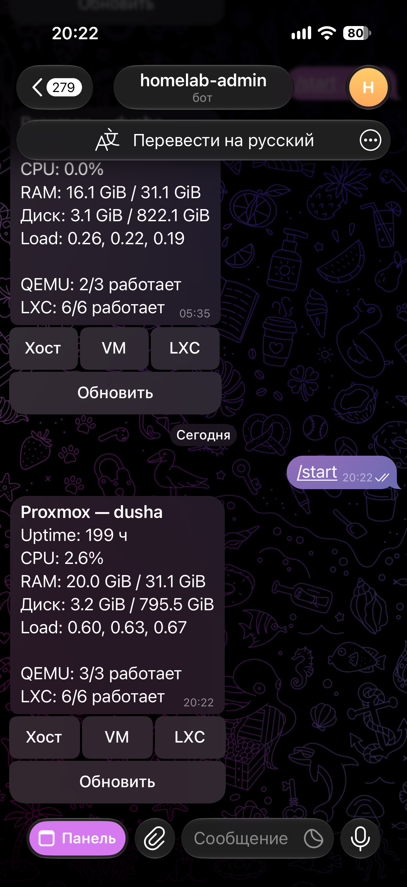

# Bot 🤖 — кнопки в Telegram, про Proxmox он ничего не знает

English: [README.en.md](README.en.md)

aiogram 3, long polling. Сводка, списки QEMU/LXC, питание гостя с подтверждением и выключение хоста в два шага. В PVE он не ходит. Ходит в backend, и этого ему хватает.

Вот чат. Это не мини-апп: сообщение, под ним кнопки. Кнопка **«Панель»** внизу экрана уже открывает мини-апп, про него читай в [app](../app/README.md).



Стенд целиком, LXC и токен PVE: [корневой README](../README.md). Контракт API: [backend](../backend/README.md).

### Как устроен заход

`core/main.py` поднимает `Bot` + `Dispatcher`, вешает `AccessMiddleware` на каждый апдейт и только потом отдаёт его `src/handlers/router.py`.

Middleware (`src/core/middleware.py`) достаёт `from_user.id` и `chat.id` и спрашивает backend `GET /access` с заголовками `X-Bot-Token`, `X-Telegram-User-Id`, `X-Telegram-Chat-Id`. Не 204 → ответ «Нет доступа.» и хендлер даже не вызывается. В логе будет `access denied for user_id=… chat_id=…` — этими числами и заполняй `ADMIN_*` на **backend**, не в боте. Бот чужие id не хранит.

Два чата, которые backend считает своими:

- группа `ADMIN_CHAT_ID` — сюда пишешь `/start`, тут кнопки;
- личка `MINI_APP_CHAT_ID` — отсюда открывают Mini App (кнопка меню). Сам бот команды из лички не примет, если этот chat id не совпал с тем, что лежит в Mongo. Обычно в Mongo две записи с одним user id.

Группа без прав админа у бота всё равно работает: боту хватает читать сообщения и жать callback. Privacy mode в BotFather может спрятать обычный текст, на команды и кнопки это не влияет. `/start` бот видит.

### Экраны

Всё inline-клавиатура, текст HTML.

| Кнопка / команда | Куда ведёт |
|------------------|------------|
| `/start`, «обновить» | `GET /summary` |
| список VM / LXC | постранично, `PAGE_SIZE` в `src/text.py` |
| карточка гостя | статус, кнопки действий |
| действие | сначала «подтвердить», потом `POST /guests/...` |
| хост | карточка ноды и «Выключить хост…» в два подтверждения |

После `start` / `stop` / `shutdown` / `reboot` / `suspend` / `resume` бот сам опрашивает гостя, пока статус не станет ожидаемым (или не выйдет терпение), и пишет отдельное сообщение, кто нажал. `src/power_outcome.py`.

Выключение хоста: `h:sd:1` → `h:sd:2` → `POST /node/shutdown`. Отдельной кнопки reboot в боте нет — она есть в Mini App. Если пульт живёт LXC-ом на этой же ноде, после удачного shutdown бот замолчит вместе с сервером. Поднять обратно он не сможет. Защита `PROTECTED_GUESTS` эту кнопку не перехватывает: она про гостей, не про питание ноды.

Ошибки backend (403 protected, 400 переход, 502 Proxmox) показываются куском текста, обрезанным до ~300 символов.

Если `WEBAPP_URL` не пустой, при старте бот вызывает `setChatMenuButton`: кнопка «Панель» открывает Mini App. Это **глобальная** кнопка бота, не «только для одного чата». Кто откроет её из группы, получит отказ уже на BFF, потому что chat id будет групповой. Открывай из лички, чей id записан как `MINI_APP_CHAT_ID`.

### Прокси до Telegram

`TELEGRAM_PROXY_URL` → `AiohttpSession` (`core/proxy.py`).

- пусто, или `none` / `null` / `-` / `off` / `false` → прямой выход на `api.telegram.org`;
- `socks5://`, `socks5h://`, `socks4://`, обычный `http(s)://` — как есть;
- пароль в логе маскируется.

На домашнем Proxmox это чаще всего пусто. Прокси нужен, когда с LXC не установить исходящий 443 до Telegram. Входящие порты боту не нужны: webhook нет, слушать нечего. В `docker-compose.prod.yml` у сервиса `bot` нет `ports`.

Часы и DNS LXC влияют на бота меньше, чем на Mini App, но резолв `api.telegram.org` обязан работать. Кривой DNS в CT выглядит как «бот не стартует», хотя Proxmox живой.

### Переменные

Файл: `ENV_FILE`, иначе `bot/.env.dev`, иначе `bot/.env.prod`. В проде compose кормит процесс корневым `.env.prod`, бот просто читает окружение. Чужие ключи (`PROXMOX_*`, `MONGO_*`) игнорируются — они для API, пусть лежат в том же файле.

| Переменная | Зачем |
|------------|--------|
| `APP_ENV` | `dev` → DEBUG |
| `TELEGRAM_BOT_TOKEN` | BotFather |
| `TELEGRAM_PROXY_URL` | необязательно |
| `API_BASE_URL` | локально `http://127.0.0.1:8000`, в compose `http://api:8000` |
| `BOT_API_TOKEN` | **тот же** секрет, что у backend и у Mini App |
| `WEBAPP_URL` | публичный HTTPS Mini App; пусто → кнопку меню не ставим |

Шаблоны: [`bot/.env.dev.example`](.env.dev.example), корневой [`.env.prod.example`](../.env.prod.example).

`BOT_API_TOKEN` — не токен Telegram и не токен PVE. Это общий пароль между ботом, BFF и FastAPI. Разъехался на одном из трёх — будет 403 на ровном месте.

### Запуск

```bash
cd bot
python -m venv .venv && .venv/bin/pip install -r requirements.txt
cp .env.dev.example .env.dev
python run.py
```

Рядом должен жить backend. Для игры без PVE подними mock: [корневой README](../README.md), разделы Dev и Demo.

Прод: образ `Docker/Dockerfile.prod` (`python:3.12-slim`, `PYTHONPATH=/app`). Сервис стартует после `api`, `restart: unless-stopped`. После ребута ноды бот поднимется сам, **если** гостевая ОС и Docker стартовали. После shutdown ноды — нет.

```bash
docker compose -f docker-compose.prod.yml logs -f bot
```

В логе при здоровом старте есть строка про прямой коннект или про прокси, и при непустом `WEBAPP_URL` — `WebApp menu button set`.

### Тесты

```bash
cd bot
python -m venv .venv && .venv/bin/pip install -r requirements-dev.txt
.venv/bin/ruff check . && .venv/bin/ruff format --check .
.venv/bin/python -m pytest -q
```

### Каталог

```
bot/
  run.py
  core/main.py          # polling, menu button
  core/settings.py
  core/proxy.py
  src/handlers/router.py
  src/api/api_client.py # клиент backend
  src/core/middleware.py
  src/text.py           # тексты и клавиатуры
  src/power_outcome.py  # ожидание статуса после кнопки
  Docker/Dockerfile.prod
  tests/
```
